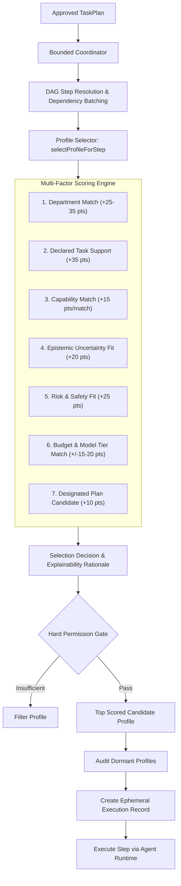
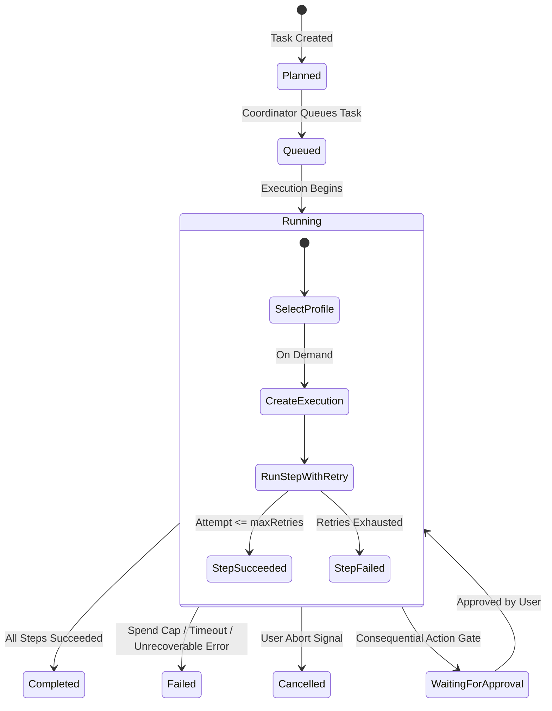

# Architecture Guide: Demand-Based Selection and Bounded Orchestration

**Status:** Stable  
**Module:** `@terrarium/contracts`, `@terrarium/core`, `apps/cli`  
**Relevant Plans:** PLAN.md Section 5.1 (Activation Policy), Section 5.2 (Execution Bounds), Section 5.3 (Lifecycle Transitions), Section 5.4 (Delegation & Coordination), Section 14 (CLI / TUI)  
**Lead Roles:** A1 (Platform & Architecture), A2 (Orchestration & AI Runtime), A3 (Data, Security & Reliability), A4 (CLI/TUI Designer & Developer), A5 (Frontend/Product Interface Designer & Developer)

---

## 1. Executive Summary & Core Architectural Invariants

TERRARIUM rejects the premise of always-on agent swarms or persistent agent loops that idle in the background. In accordance with **PLAN_CONTEXT.md Section 5** ("Agent identities are not the same as running agent processes"):

1. **Profiles are Dormant Catalog Definitions:** An `AgentProfile` is a declarative capability template stored in the registry or database. It costs zero tokens, consumes zero compute, and maintains no background state when idle.
2. **Separation of Selection and Execution:** Selecting an agent profile for a plan step is purely a declarative matching computation. It does **not** instantiate an execution or session.
3. **Execution Creation Only on Demand:** An `Execution` entity is created **strictly** when a step is scheduled to run. It tracks token usage, runtime duration, cost, outputs, evidence, and provider telemetry.
4. **Strict Operational Bounds:** Every orchestrated run operates under immutable bounding limits: maximum delegation depth, step and total timeouts, maximum concurrency, bounded retries, and explicit dollar spend caps.
5. **Preservation of Disagreements and Dissent:** When customer personas or specialist agents provide diverging feedback, TERRARIUM never forces a false consensus. Disagreements and counter-evidence are structured and preserved in the final `TaskResult`.

---

## 2. Demand-Based Selection Architecture



### 2.1 Multi-Factor Scoring Factors

The `ProfileSelector` scores all available profiles without starting processes:
- **Department Match:** Exact match with requested department (+35 pts); match with step department (+25 pts).
- **Task Support:** Explicit declaration of the classified task type (+35 pts).
- **Capability Overlap:** Direct match of step candidate capabilities against agent capabilities (+15 pts per match).
- **Epistemic Uncertainty:** When uncertainty is `high` or `extreme`, preference is awarded to research, strategy, and architecture specialists (+20 pts).
- **Risk Sensitivity:** When risk is `high` or `critical`, safety, quality, and security specialist profiles are prioritized (+25 pts).
- **Budget Awareness:** When remaining dollar budget is tight (< $0.15), fast-tier profiles are prioritized (+20 pts) and advanced-tier profiles are penalized (-15 pts).
- **Designated Plan Candidate:** Affinity awarded to candidates designated during plan synthesis (+10 pts).

### 2.2 Proof of Dormancy

Unselected profiles remain completely dormant:
```typescript
const dormancyReport = await selector.getDormancyReport(activeProfileIds);
// dormancyReport.dormant: array of all registered profiles that were NEVER instantiated
```
This is verified in tests and printed in every CLI and Studio execution audit.

---

## 3. Bounded Orchestration & Lifecycle State Machines

Orchestrated workflows transition through well-defined lifecycle states enforced by domain assertion utilities:



### 3.1 Bounding Limits Enforced

| Boundary | Default Value | Hard Operational Ceiling | Enforced By |
| :--- | :--- | :--- | :--- |
| **Max Delegation Depth** | `2` | `5` | `DelegationManager` (blocks recursive agent loops) |
| **Max Concurrency** | `2` | `10` | `BoundedCoordinator` (DAG batch chunking) |
| **Max Retries** | `2` | `5` | `BoundedCoordinator` (exponential backoff & transient retry) |
| **Step Timeout** | `30,000 ms` | `300,000 ms` | Per-step `AbortController` timer |
| **Total Task Timeout** | `120,000 ms` | `600,000 ms` | Master run timer |
| **Dollar Spend Cap** | `$2.00` | `$50.00` | Pre-step budget checker (`SpendLimitExceededError`) |

---

## 4. Fault Tolerance & Recovery Behavior

1. **Idempotency:** When an `idempotencyKey` is passed to `executePlan`, previous execution results are cached and instantly re-delivered without re-running agents or consuming spend.
2. **Transient Failures & Bounded Retries:** When a provider fails with a transient error (rate limit, connection drop), the coordinator executes up to `maxRetries` attempts, emitting `step_retry` events.
3. **Retry Exhaustion & Partial Completion:** If all retries fail, execution halts cleanly with `status = 'failed'` and `isPartial = true`. All previously completed step outputs and evidence items are preserved.
4. **User Cancellation:** When an `AbortSignal` fires, active steps abort immediately, the task transitions to `'cancelled'`, and completed step outputs remain accessible.
5. **Consequential Action Approval:** Steps requiring human verification pause execution into `'waiting_for_approval'` until explicit operator authorization is granted.

---

## 5. Output Preservation, Evidence & Disagreements

The coordinator preserves all granular outputs into the immutable `TaskResult`:
- **Evidence Items:** Structured facts with citations (`confidence: 'high' | 'medium' | 'low' | 'simulated'`). Simulated customer personas explicitly declare `'simulated'` confidence.
- **Disagreements:** Preserves structured debates between personas or agents:
  - `topic`: e.g. "Pricing Tier Feasibility"
  - `positions`: each agent's perspective, rationale, and cited evidence.
- **Unresolved Questions:** Ambiguities or technical debt flagged during execution for human review.

---

## 6. CLI Usage & Live Inspection

### 6.1 Executing with Live Event Stream
```bash
terrarium task execute "Conduct an architecture review of packages/core"
```

### 6.2 Inspection / Explainability Only
```bash
terrarium task execute "Conduct an architecture review of packages/core" --explain-only
```
Renders the demand-based selection audit proving which profiles were activated, their selection scores, and which registered profiles remained dormant.

### 6.3 Structured JSON Output
```bash
terrarium task execute "Conduct an architecture review of packages/core" --json
```

---

## 7. Studio Compatibility (A5)

The orchestration data structures (`OrchestrationResult`, `StepExecutionResult`, `OrchestrationEvent`, `ProfileSelectionDecision`) are 100% serialized and typed for future Web / Studio consumption:
- WebSocket event streaming via typed `OrchestrationEvent` discriminated union.
- Interactive DAG visualization with live step badges (`pending`, `running`, `completed`, `failed`).
- Side-by-side Persona disagreement comparison cards.
- Live token burn down and budget progress meters.
