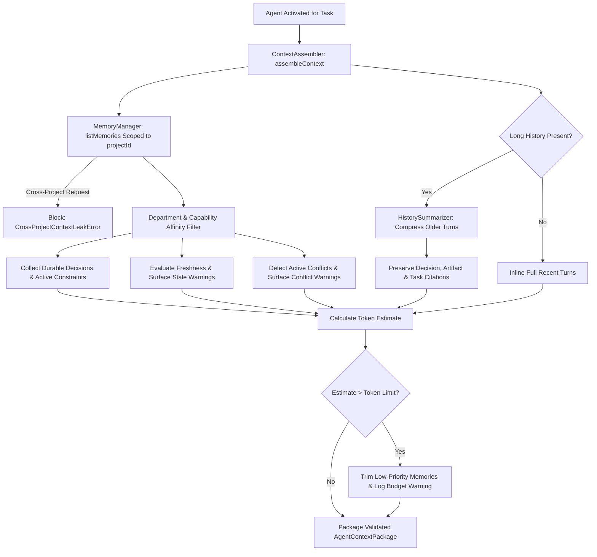
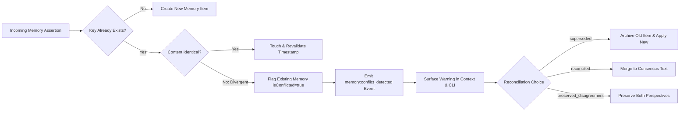

# TERRARIUM — Project Memory & Context Management Architecture

## 1. Overview & Mission

TERRARIUM coordinates virtual organizations of specialized AI agents working across projects, tasks, reviews, and debates. Preserving useful context across agent invocations and sessions is fundamental to delivering verified deliverables without repeating expensive analysis.

In accordance with **`PLAN.md Section 14` (Memory and Knowledge Management)** and **`PLAN_CONTEXT.md Section 6` (Context and Memory Discipline)**, TERRARIUM enforces four non-negotiable architectural invariants:

1. **Scoped Retrieval over Naive Broadcasting:** Instead of broadcasting the entire repository or whole conversation history to every agent, the system packages only the context strictly required for the specific agent's role, department, capabilities, and active task.
2. **Surface Stale and Conflicting Memory:** The system never silently clobbers or overwrites conflicting assertions. Contradictions trigger explicit conflict tracking, surface warning banners to operators and agents, and require explicit reconciliation (supporting Preserved Specialist Disagreements). Stale items exceeding category freshness TTLs are flagged for revalidation before reliance.
3. **History Summarization with Retained Citations:** When conversation or execution turn histories grow long, older turns are compressed into compact structured summaries while explicitly identifying and retaining decision IDs (`DEC-001`), artifact paths, commit SHAs, and task IDs.
4. **Strict Project Isolation & Sensitive Data Minimization:** Cross-project context access is strictly blocked (`CrossProjectContextLeakError`). High-entropy credentials, tokens, Bearer strings, and API keys are automatically sanitized via `@terrarium/config` secret redactors prior to persistent storage or context package assembly.

---

## 2. Memory Taxonomy & Canonical Categories

All project memory items are categorized under the 9 canonical categories defined in `PLAN.md Section 14`:

| Category | UI Icon | Default TTL | Description & Purpose |
| :--- | :---: | :---: | :--- |
| `project_overview` | 📋 | 60 days | High-level product promise, objectives, milestones, and scope boundaries. |
| `confirmed_requirement` | ✅ | 90 days | Verified functional, security, performance, or operational invariants. Generates active constraints. |
| `decision_rationale` | ⚖️ | 365 days | Architectural decision records (ADRs) with rationale, evaluated alternatives, and date. |
| `architecture_knowledge` | 🏛️ | 180 days | System architecture diagrams, package dependency rules, boundary contracts, and tech stack choices. |
| `research_finding` | 🔍 | 14 days | Empirical benchmark data, competitor intelligence, or discovery notes. Higher volatility. |
| `open_question` | ❓ | 7 days | Unresolved ambiguities or pending clarifications requiring user or stakeholder input. |
| `known_risk` | ⚠️ | 30 days | Technical debt, security exposure, compliance hurdles, or performance bottlenecks. |
| `agent_summary` | 📝 | 14 days | Concise roll-up summaries of completed agent tasks and intermediate outcomes. |
| `user_preference` | ⭐ | 180 days | Operator-approved project defaults (e.g. terminal theme, format styles, preferred tools). |

---

## 3. Provenance, Freshness, and Confidence Model

### 3.1 Confidence Levels
- **`confirmed` [CONFIRMED]:** Verified facts backed by repository evidence, passing test suites, or explicit user confirmation.
- **`hypothesis` [HYPOTHESIS]:** Tentative working theory awaiting verification. Never relied upon as established truth.
- **`inferred` [INFERRED]:** Derived conclusions from model analysis or heuristic deductions.
- **`simulated` [SIMULATED]:** Generated persona feedback from simulated customer intelligence agents.

### 3.2 Freshness Lifecycle
Every memory item tracks `createdAt`, `updatedAt`, and `lastValidatedAt`. Freshness is evaluated against the category TTL window:
- **`fresh` (🟢 Fresh):** Age $\le$ TTL window. Ready for active reliance.
- **`stale` (🟡 Stale):** TTL window $<$ Age $\le$ $2 \times$ TTL window. Requires revalidation before quoting as fact.
- **`expired` (🔴 Expired):** Age $> 2 \times$ TTL window. Obsolete; discarded or isolated.
- **`superseded` (⚪ Superseded):** Explicitly replaced by a newer decision or finding.

### 3.3 Full Provenance Tracking
Memory items record origin details:
- `sourceType`: `file`, `task`, `user`, `report`, `commit`, `tool_call`, `debate`, `conversation`, or `system`.
- `sourceReference`: Specific URI, file path with line numbers, or task ID.
- `author`: Agent slug or user who asserted the memory.
- `rationale`: Verifiable reason or evidence summary supporting the assertion.

---

## 4. Context Assembly & History Summarization Pipeline

---

## 5. Conflict Resolution Workflow

When a new assertion conflicts with an existing durable memory item, TERRARIUM rejects silent clobbering:

---

## 6. Operator CLI & Terminal Inspectability

The following commands are available under `apps/cli`:

- `terrarium memory list [--category <cat>] [--json]`: Lists memory items in a formatted table with freshness glyphs and confidence badges.
- `terrarium memory show <id> [--json]`: Inspects a comprehensive memory card detailing provenance, freshness, content, and conflict status.
- `terrarium memory set --key <k> --category <c> --content <text>`: Records or updates a memory assertion.
- `terrarium memory correct <id> --content <text>`: Corrects an existing memory record.
- `terrarium memory delete <id> [--archive-only]`: Permanently deletes or archives a memory record.
- `terrarium memory conflicts`: Displays all unresolved conflicts and divergent specialist perspectives across the project.
- `terrarium context assemble --agent <slug> --task <id>`: Assembles and previews the exact context package and token budget that will be injected into an agent.
