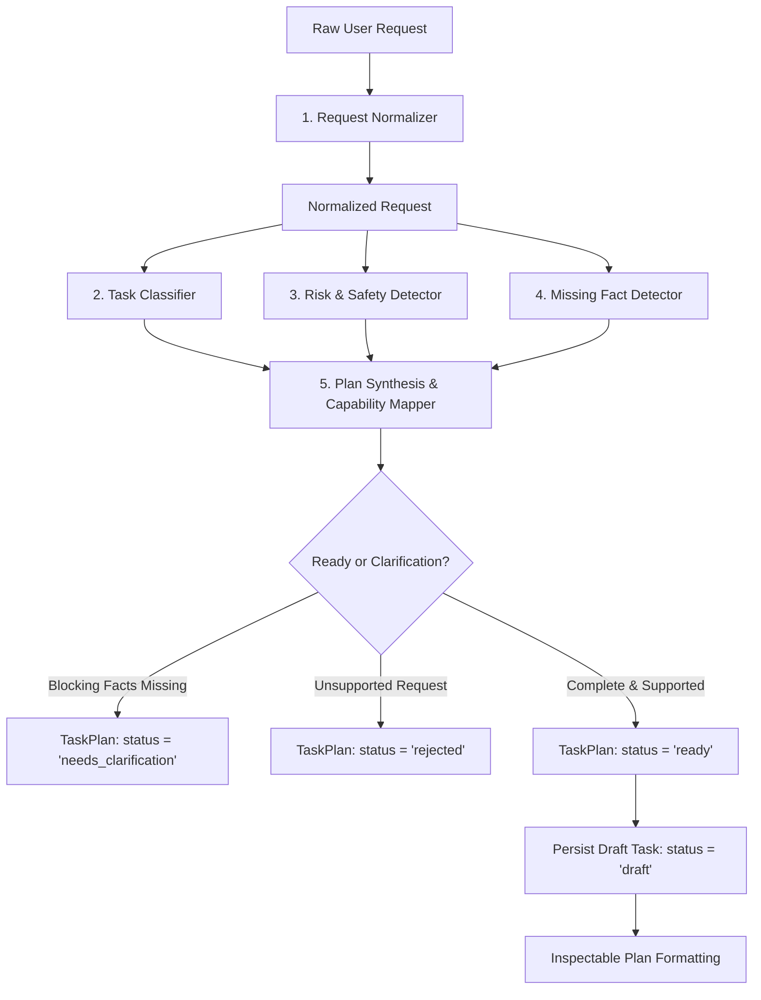

# Architecture Guide: Task Intake, Classification, and Planning

**Status:** Stable  
**Module:** `@terrarium/contracts`, `@terrarium/core`, `apps/cli`  
**Relevant Plans:** PLAN.md Section 5.1 (Activation Policy), Section 5.4 (Task Lifecycle), Section 6.1 (Project Intake), Section 14 (CLI / TUI)  
**Lead Roles:** A1 (Lifecycle & Domain Boundaries), A2 (Classification & Capability Mapping), A3 (Risk, Ambiguity & Invariants), A4 (CLI / TUI Interaction), A5 (Plan Readability & Presentation)

---

## 1. Executive Summary

Task intake and planning in TERRARIUM establishes a disciplined, deterministic bridge between raw user intent and structured orchestration.

In accordance with **PLAN_CONTEXT.md Section 5** ("Agent identities are not the same as running agent processes") and Prompt 7 requirements, **planning strictly classifies, estimates, graphs, and prepares tasks without executing agents, calling external LLM providers, or invoking tools**. 

The lifecycle normalizes input without altering user intent, classifies the task type and project scope, maps candidate capabilities and agent profiles, assesses operational risk and epistemic uncertainty, formulates structured clarification questions when critical facts are missing, and synthesizes an inspectable, explainable plan.

---

## 2. The Request-to-Draft Lifecycle



### 2.1 Step 1: Input Normalization (`request-normalizer.ts`)
- **Intent Invariant:** Semantic content, casing, and user vocabulary are never altered.
- **Normalization:** Trims leading/trailing whitespace, standardizes line breaks (`\r\n` -> `\n`), strips outer markdown code block wrappers if pasted accidentally, and reduces redundant blank lines.
- **Directive & Path Extraction:** Detects explicit department hints (`@engineering`, `dept:security`), priority hints (`priority:urgent`), and references to project paths (e.g. `packages/core`, `src/index.ts`).

### 2.2 Step 2: Deterministic Classification (`task-classifier.ts`)
- Evaluates prompt intent across 11 canonical task types:
  1. `architecture_review`: Subsystem boundaries, decoupling, modularity, and trade-offs.
  2. `code_generation`: New features, scaffolding, and schema implementations.
  3. `bug_fix`: Defect resolution, root cause analysis, and regression tests.
  4. `security_audit`: Threat modeling, vulnerability scanning, and permission audits.
  5. `customer_simulation`: Simulated buyer persona reactions and adoption barrier analysis.
  6. `business_strategy`: Business model hypotheses, unit economics, and competitive alternatives.
  7. `test_generation`: Deterministic test suites, branch coverage, and assertion authoring.
  8. `refactoring`: Decoupling, simplification, and complexity reduction.
  9. `documentation`: Technical markdown documentation, guides, and API specs.
  10. `general_inquiry`: Direct questions and contextual codebase explanations.
  11. `unsupported`: Out-of-scope non-software actions, physical execution, unverified legal/medical counsel, or unauthorized actions.
- Resolves primary and secondary departments from the 10 canonical departments.
- Identifies project context, scope (`conceptual`, `single_file`, `multi_file`, `module`, `full_codebase`), and detected technologies.

### 2.3 Step 3: Risk Evaluation & Safety Gates (`risk-detector.ts`)
- Scored on a 0–100 scale into 4 risk tiers:
  - **Low (0–25):** Read-only inspection and analysis.
  - **Medium (26–50):** Non-destructive code generation, test authoring, and bounded refactoring.
  - **High (51–80):** File deletions, modifying credentials/environment files, installing new dependencies, and shell execution.
  - **Critical (81–100):** Dropping database tables, recursive file deletions, bypassing security/authentication controls, or deploying to production.
- Triggers explicit human-in-the-loop approval gates (`requiresApproval: true`) for consequential actions per PLAN_CONTEXT.md Section 7.

### 2.4 Step 4: Epistemic Uncertainty & Clarification (`missing-fact-detector.ts`)
- Detects underspecified requests, vague bug reports lacking stack traces or file pointers, and optimizations lacking target benchmarks.
- Formulates structured `ClarificationQuestion` items categorized by scope, target, constraints, permissions, or business logic.
- Distinguishes `blocking` questions (which halt plan progression until answered) from `advisory` questions.
- If answers are provided via `TaskIntakeInput.clarificationAnswers`, automatically resolves them.

### 2.5 Step 5: Plan Synthesis (`plan-generator.ts`)
- Generates a DAG of sequential steps following the bounded lifecycle: **Inspect -> Act -> Verify**.
- Resolves candidate agent profiles from `AgentRegistry.resolve(...)` using multi-factor capability scoring.
- Computes granular budget estimates (tokens, USD cost, duration, and model tier distribution).
- Compiles an explainable `SelectionRationale` covering task type, department, capability, sequence, and risk mitigation rationale.
- Establishes concrete, verifiable `completionCriteria`.

---

## 3. Strict Invariant: Zero Execution During Planning

A critical architectural invariant in TERRARIUM is that task intake, classification, and planning must **never** execute agents, tools, or provider LLMs:
1. **Zero Provider API Calls:** Planning runs offline with zero external token expenditure or network roundtrips.
2. **Zero Tool Spawning:** Shell commands, file mutations, and destructive scripts are never run during intake.
3. **Zero Active Sessions:** Interactive session processes are not started; agent definitions remain pure declarative metadata in the registry.

This invariant is verified deterministically in `packages/core/tests/task-intake.test.ts`.

---

## 4. Persistence Architecture

Migration `003_task_plans.ts` introduces durable storage for inspectable plans:
```sql
CREATE TABLE IF NOT EXISTS task_plans (
  id TEXT PRIMARY KEY,
  task_id TEXT REFERENCES tasks(id) ON DELETE SET NULL,
  status TEXT NOT NULL,
  task_type TEXT NOT NULL,
  risk_level TEXT NOT NULL,
  uncertainty_level TEXT NOT NULL,
  raw_input TEXT NOT NULL,
  normalized_input TEXT NOT NULL,
  plan_json TEXT NOT NULL,
  created_at TEXT NOT NULL,
  updated_at TEXT NOT NULL
);

CREATE INDEX IF NOT EXISTS idx_task_plans_task_id ON task_plans(task_id);
CREATE INDEX IF NOT EXISTS idx_task_plans_status ON task_plans(status);
CREATE INDEX IF NOT EXISTS idx_task_plans_task_type ON task_plans(task_type);
```

When draft task persistence is enabled, a corresponding record is created in the `tasks` table with `status = 'draft'`.

---

## 5. User Interaction & CLI Commands

The CLI exposes two primary commands for task intake:

### Inspecting a Plan
```bash
terrarium task plan "Conduct an architecture review of packages/core"
```
Produces rich terminal output with ANSI badges, DAG dependencies, resource estimates, and selection rationale.

### Machine-Readable Outputs
```bash
# JSON output for automation or Studio integration
terrarium task plan "Write unit tests for packages/contracts" --json

# GitHub Flavored Markdown with Mermaid diagram
terrarium task plan "Review security audit of auth handlers" --markdown
```

### Answering Clarification Questions
```bash
terrarium task plan "Fix the bug in packages/core/src/index.ts" \
  --answer clarify_bug_details="Uncaught TypeError at line 42 when options is undefined"
```
Resolves blocking questions and transitions the plan from `needs_clarification` to `ready`.
