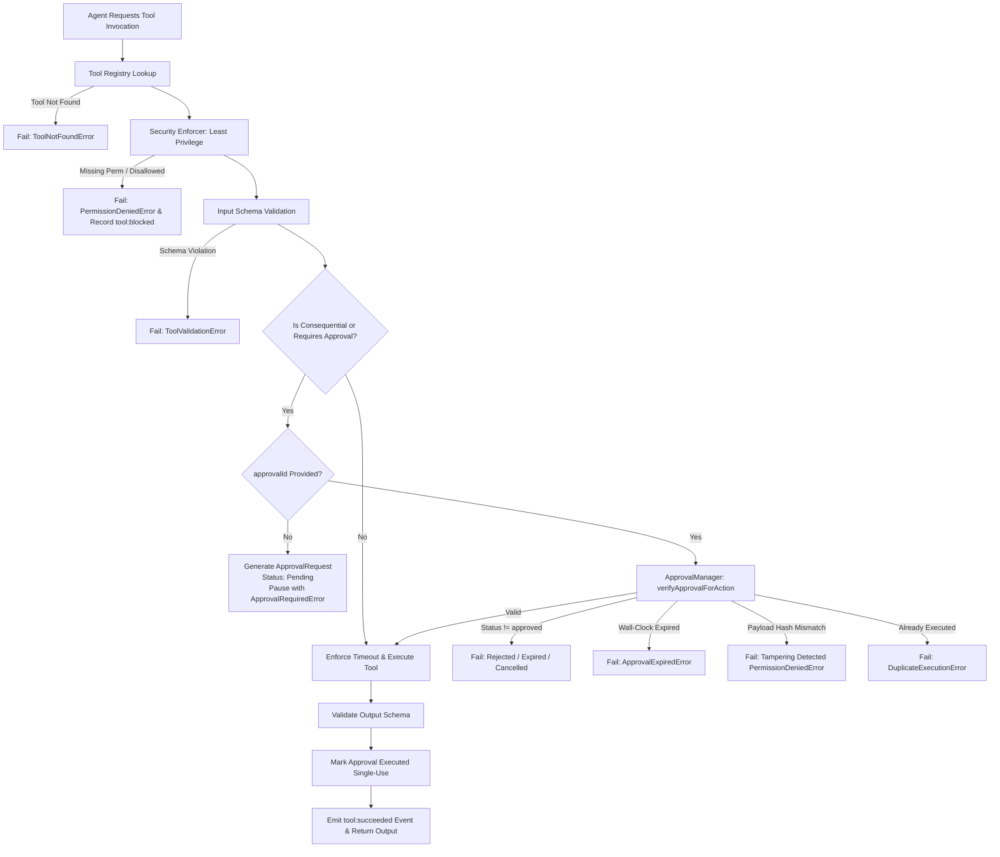

# TERRARIUM — Tool Registry, Permissions, and Human Approval Architecture

## 1. Overview & Mission

TERRARIUM coordinates multi-agent workflows to inspect, evaluate, plan, build, review, test, and improve software products. As agents perform work, they require access to tools (filesystem operations, shell command execution, git operations, cloud deployments, and external communications).

In accordance with **`PLAN.md Section 17` (Security, Privacy, and Trust)** and **`PLAN_CONTEXT.md Section 7` (Autonomy & Permissions)**, TERRARIUM enforces three non-negotiable guarantees:

1. **Least-Privilege Tool Access:** Agents can only execute tools explicitly permitted by their granted permissions, and can never invoke tools placed in their profile `disallowedTools`.
2. **Mandatory Human Control for Consequential Operations:** Consequential actions—such as permanent file deletions, external package publishing, remote production deployments, external message broadcasts, or destructive shell operations—cannot execute autonomously. They are paused at runtime, generate inspectable approval requests, and require affirmative human authorization.
3. **Bypass & Replay Resistance:** Neither retries, orchestrator delegation, child subagents, nor payload tampering can bypass rejected, expired, or cancelled approvals. Approved tokens are strictly single-use to prevent duplicate execution or replay attacks.

---

## 2. Tool Classification & Metadata

Every tool registered in TERRARIUM exposes rich, strongly typed domain contracts (`@terrarium/contracts`):

| Property | Type | Description |
| :--- | :--- | :--- |
| `id` | `string` | Unique reverse-domain tool identifier (e.g., `fs.read_file`, `git.push`). |
| `name` | `string` | Human-readable tool title. |
| `category` | `string` | Functional classification (`filesystem`, `shell`, `git`, `publishing`, `deployment`, `communication`). |
| `riskLevel` | `ToolRiskLevel` | Monotonic risk severity: `read_only` (0), `low` (1), `medium` (2), `high` (3), `critical` (4). |
| `sideEffectClass` | `ToolSideEffectClass` | Operational impact: `none`, `idempotent`, `state_mutating`, or `consequential`. |
| `requiredPermissions` | `string[]` | Permission tokens required to invoke (e.g. `file:read`, `shell:execute`, `git:push`, `publish:external`). |
| `inputSchema` | `ToolJsonSchema` | Strict JSON schema specifying parameter types, required fields, defaults, and constraints. |
| `outputSchema` | `ToolJsonSchema` | Strict JSON schema validating returned data. |
| `defaultTimeoutMs` / `maxTimeoutMs` | `number` | Bounded execution timeouts enforced via AbortSignal. |
| `requiresApproval` | `boolean \| Predicate` | Explicit human approval gate. Evaluated statically or dynamically against input parameters. |
| `isConsequential` | `boolean \| Predicate` | Consequential impact flag. |

---

## 3. The Invocation & Approval Pipeline



---

## 4. Consequential Operations & Approval Gates

Human review is required for the following consequential operations:

1. **File Deletion & Destructive Edits (`file_delete`):** Any unlinking or recursive deletion of filesystem artifacts.
2. **Git Remote Push (`git_push`):** Modifying remote repository branches, especially force pushes.
3. **Production Deployments (`production_deploy`):** Triggering live service deployments, updating running clusters, or changing production infrastructure.
4. **External Publishing (`external_publish`):** Distributing packages or artifacts to external registries (npm, PyPI, Maven, crates.io).
5. **External Messaging (`message_send`):** Dispatching external notifications, emails, or chat messages to external stakeholders.
6. **Destructive Shell Commands (`destructive_operation`):** Commands matching high-risk signatures (`rm -rf`, `DROP TABLE`, `mkfs`, `git reset --hard`).
7. **Paid Usage & Payments (`paid_api_call`):** Any operation that directly incurs monetary transactions or third-party paid API consumption.

---

## 5. Security Invariants & Bypass Resistance

1. **Tamper Detection (SHA-256 Payload Hash):**
   When an approval request is generated, a deterministic SHA-256 hash is calculated over the canonicalized (sorted-key) input payload:
   $$\text{hash} = \text{SHA256}(\text{toolId} : \text{sortedJSON}(\text{input}))$$
   When the approval token is presented during execution, the current payload is rehashed. Any attempt to modify parameters after human review (e.g., changing `rm /tmp/scratch` to `rm /etc/passwd`) is immediately blocked as a tampering attempt.

2. **Terminal State Immutability:**
   Approval status transitions adhere to a strict state machine:
   $$\text{pending} \longrightarrow \{\text{approved}, \text{rejected}, \text{expired}, \text{cancelled}\}$$
   Terminal states cannot transition to any other state. Retrying a rejected approval or resurrecting an expired approval is strictly rejected.

3. **Single-Use Replay Attack Protection:**
   Once an approval token is consumed to execute a tool, it is marked as `isExecuted: true` with an `executedAt` timestamp. Any subsequent attempt to invoke the tool with the same approval ID fails with `DuplicateExecutionError`.

4. **Task Boundary Isolation:**
   Approvals are bound to a specific `taskId`. An approval authorized for `taskId: task-001` cannot be reused under a different task `taskId: task-999`.

---

## 6. Observability & Audit Trail

All critical security decisions and tool operations publish structured `DomainEvent` records to the audit log:

- `tool:invoked`: Tool execution commenced.
- `tool:succeeded`: Tool executed successfully with duration and output metadata.
- `tool:failed`: Tool execution failed or timed out.
- `tool:blocked`: Tool execution blocked by permission denied, missing approval, rejected approval, expired approval, or tampering attempt.
- `approval:requested`: Consequential action paused and queued for human review.
- `approval:approved`: Human authorized the pending action.
- `approval:rejected`: Human rejected the proposed action.
- `approval:expired`: Approval timed out without a decision.
- `approval:cancelled`: Approval revoked by user or orchestrator.

---

## 7. CLI Inspection & Interaction

TERRARIUM provides comprehensive CLI commands for developers and operators:

```bash
# List all registered tools with risk levels, permissions, and approval requirements
terrarium tools list
terrarium tools list --category git
terrarium tools list --risk critical --json

# Inspect detailed tool schemas and timeout limits
terrarium tools info fs.delete_file

# Review pending approvals requiring human decision
terrarium approvals list
terrarium approvals list --status pending

# Inspect a specific approval request with full consequence analysis and payload preview
terrarium approvals show appr-a1b2c3d4-e5f6

# Authorize, decline, or cancel an approval request
terrarium approvals approve appr-a1b2c3d4-e5f6 --reason "Approved for release window"
terrarium approvals reject appr-a1b2c3d4-e5f6 --reason "Target branch is incorrect"
terrarium approvals cancel appr-a1b2c3d4-e5f6 --reason "Task superseded"
```
